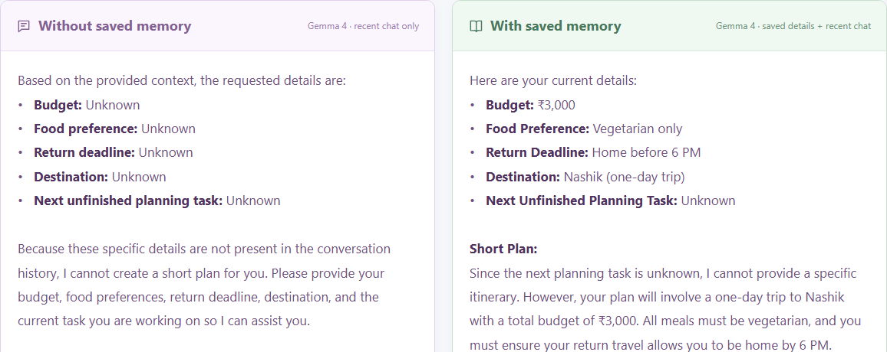
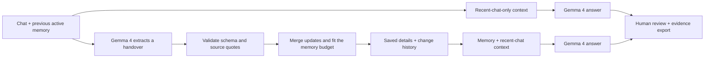

<div align="center">


# ContextCarry

### A fresh conversation. Not a fresh start.

**A source-linked memory notebook for AI—powered by Gemma 4.**

[](https://github.com/shiv-69-debug/contextcarry/actions/workflows/ci.yml)
[](LICENSE)
[](#run-it-locally)
[](#where-gemma-4-is-used)

[**Watch / download the demo**](https://github.com/shiv-69-debug/contextcarry/releases/download/v0.1.0/contextcarry-demo.mp4) · [**Demo release & evidence**](https://github.com/shiv-69-debug/contextcarry/releases/tag/v0.1.0) · [**Run locally**](#run-it-locally) · [**AI disclosure**](#ai-tools-and-authorship)

Built for **Hacktoberfest × MSC KBTCOE Nashik 2026**, **Best Use of Gemma 4**.

</div>

---

## The idea in 30 seconds

Imagine handing your project to a new teammate. You would leave them the **goal, latest decisions, important constraints, and next steps**—not make them read every conversation you ever had.

**ContextCarry gives AI that handover.** It uses Gemma 4 to save important information, links each memory to its original message, and compares what a fresh AI call remembers **with and without the saved memory**.

> **Example:** “My trip budget is ₹2,000.” → “Actually, make it ₹3,000.”
>
> The next conversation should remember **₹3,000**, keep your other preferences, and know what remains unfinished.

## Watch it work

[](https://github.com/shiv-69-debug/contextcarry/releases/download/v0.1.0/contextcarry-demo.mp4)

**[Open the 70-second captioned demo video →](https://github.com/shiv-69-debug/contextcarry/releases/download/v0.1.0/contextcarry-demo.mp4)**

The video shows **genuine Gemma 4 requests**: save memory, inspect its source, compare two answers, and inspect the exact model input. It contains captions and no API-key entry screen. The screenshot above is from that live recording, not the automated test fixtures.

**For judges:** watch the demo, read the [Gemma breakdown](#where-gemma-4-is-used), then inspect the [measured results](#what-we-measured). The [presentation guide](docs/DEMO.md) explains the project and likely technical questions.

## The problem

An AI model can only use the context supplied to it. When older messages are dropped or compressed, it may lose:

- The goal you originally explained.
- Constraints such as a budget, preference, or deadline.
- A correction that replaced an earlier decision.
- The next unfinished task.

A fluent answer can still be wrong for **your** situation. Re-explaining everything is frustrating, and an ordinary summary may omit the detail that matters.

## Our solution

**1. Add details** — use your own instructions or the included trip-planning example.

**2. Save memory** — Gemma extracts important details. The application checks their source quotes and stores a compact handover.

**3. Compare answers** — ask the same question twice. One Gemma call sees recent chat only; the other sees saved memory plus recent chat.

### What makes the implementation useful

- **Memory with evidence:** click a saved detail to see its original user message.
- **Decision updates:** replace an explicitly corrected value under the same key; keep the earlier version in the change history.
- **Visible memory loss:** details that do not fit the memory budget are recorded as dropped.
- **Bounded repair:** invalid extraction output gets one corrective attempt, with strict validation still applied.
- **Inspectable comparisons:** view the exact input sent to either call.
- **Honest review:** text matches are suggestions; a human marks whether each fact was actually remembered.
- **Portable evidence:** download prompts, responses, token usage, timing, and reviews as JSON.

This is an original small memory pipeline and evaluation interface. It builds on established ideas in AI memory; it does not claim to invent the concept of remembering across sessions.

## Where Gemma 4 is used

The recorded demo uses **`gemma-4-26b-a4b-it`**. The app also supports **`gemma-4-31b-it`**.

**Gemma is the model; Gemini API is the service used to access it.** Both comparison answers come from the same Gemma 4 model.

| User action | Gemma's job | Calls | Implementation |
| --- | --- | --- | --- |
| **Test & connect** | Respond to a small connection check | 1 | [`server.js`](server.js) |
| **Save memory** | Select durable facts, resolve explicit updates, and return source-linked entries | 1; at most 1 extra repair | [`src/service.js`](src/service.js), [`src/prompts.js`](src/prompts.js) |
| **Compare: without memory** | Answer using recent chat only | 1 | [`src/service.js`](src/service.js) |
| **Compare: with memory** | Answer using saved details plus recent chat | 1 | [`src/service.js`](src/service.js) |

All model requests use the REST adapter in **[`src/gemma.js`](src/gemma.js)**. JavaScript—not Gemma—checks quotes, merges entries, enforces character budgets, protects credentials, and records the evaluation.

**No fine-tuning or training is performed.** No model weights are bundled. Gemma's open-weight model is an essential part of the running system, not just a tool used while writing the code.

### How much Gemma did the recorded demo use?

| Call | Input tokens | Output tokens | Total tokens | Model latency |
| --- | ---: | ---: | ---: | ---: |
| Save memory | 923 | 181 | 1,104 | 5.50 s |
| Answer without memory | 416 | 100 | 516 | 4.27 s |
| Answer with memory | 452 | 134 | 586 | 4.38 s |
| **Recorded run total** | **1,791** | **415** | **2,206** | Answer calls run in parallel |

**Three generation calls** were used in this successful recording. The key was already connected, and the handover needed no repair. A first-time connection adds one small call; a repaired handover adds one more.

These are provider-reported numbers for this run—not a lifetime project total or a dollar-cost estimate. Earlier setup, diagnostics, and a recording attempt that encountered an upstream HTTP 500 are excluded. Full runtime/development disclosure is in **[AI_USAGE.md](docs/AI_USAGE.md)**; the [release evidence JSON](https://github.com/shiv-69-debug/contextcarry/releases/download/v0.1.0/recording-report.json) includes the recorded responses and comparison inputs.

## What we measured

The live recording uses the included Nashik trip conversation and a **1,200-character context ceiling**. The saved handover contains **4 entries in 207 characters**.

| Detail | Correct answer | Without saved memory | With saved memory |
| --- | --- | --- | --- |
| Latest budget | ₹3,000 | Unknown | Correct |
| Food preference | Vegetarian | Unknown | Correct |
| Return deadline | Before 6 PM | Unknown | Correct |
| Destination | Nashik | Unknown | Correct |
| Next unfinished task | Choose transport | Unknown | **Missing** |
| **Manual review** | **5 checks** | **0 / 5** | **4 / 5** |

**The missed task matters.** The memory is not perfect, and we show that rather than claiming complete recall. This is a small demonstration, not a broad benchmark. See [live result notes](examples/LIVE_RESULTS.md) for failure observations and evaluation limitations.

### Why the comparison is inspectable

- Same model, question, system instructions, sampling settings, and context character ceiling.
- Baseline: the newest transcript suffix that fits.
- ContextCarry: saved memory plus the newest transcript suffix that still fits.
- Saved memory consumes part of the allowance; it is not added for free outside it.
- Expected answers are never included in either model prompt.
- System instructions and the question are outside the character ceiling and identical for both calls.

**This deliberately simulates a small context window.** It does not claim that Gemma's native context limit is 1,200 characters. Equal character ceilings also do not imply equal token counts or equal total cost: memory extraction is an additional operation.

## Run it locally

**Requires Node.js 22.9 or newer. No runtime dependencies or build step.**

```sh
git clone https://github.com/shiv-69-debug/contextcarry.git
cd contextcarry
npm start
```

Open **http://localhost:3000**.

1. Get a key from [Google AI Studio](https://aistudio.google.com/apikey).
2. Click **Connect Gemma**, enter your key, and leave **Remember on this laptop** checked.
3. Click **Test & connect**.
4. Follow **Your next step**: **Save memory → Compare answers → View answers**.

The saved key is kept server-side in the Git-ignored `.contextcarry/credentials.json`, not in browser storage or exports. On the next visit, **Saved key ready** means you can proceed immediately. Use **Model settings** to remove the stored copy. This is a local, single-user prototype; the credential file is not an encrypted vault.

<details>
<summary><strong>Alternative configuration with .env</strong></summary>

Create `.env` using [`.env.example`](.env.example):

```dotenv
GEMINI_API_KEY=your_own_key_here
GEMMA_MODEL=gemma-4-26b-a4b-it
PORT=3000
HOST=127.0.0.1
```

A key saved in the app takes precedence over `.env`. Removing it restores the environment fallback. Restart after editing `.env` manually; use `npm run dev` for server-code watch mode.

Uncheck Remember for a tab-only key. The default server binds to loopback; saving/removing credentials through the UI is restricted to localhost. Static-only hosting cannot run the Node API.

</details>

## Tests and project quality

**40 core/API tests and 6 browser tests** passed during local verification. Automated tests use explicit provider fixtures and require **no real API key**. They verify software behavior, not Gemma's accuracy.

```sh
# No dependency installation needed for these checks
npm run check
npm test

# Development-only browser tests
npm ci
npx playwright install chromium
npm run test:browser
```

Coverage includes source validation, corrected decisions, repeated handovers, budget loss, failed repairs, credential refresh/restart, API errors, safe text rendering, guided navigation, and desktop/mobile behavior. [GitHub Actions](.github/workflows/ci.yml) runs core tests on Node 22 and 24 and browser tests on Chromium.

Want to help? Start with **[CONTRIBUTING.md](CONTRIBUTING.md)**.

## How it is built



| Area | Files |
| --- | --- |
| Memory validation, updates, budgets, and text matching | [`src/memory.js`](src/memory.js) |
| Model instructions and request orchestration | [`src/prompts.js`](src/prompts.js), [`src/service.js`](src/service.js) |
| Gemma REST integration | [`src/gemma.js`](src/gemma.js) |
| Local HTTP server and credential storage | [`server.js`](server.js), [`src/credentials.js`](src/credentials.js) |
| Accessible, responsive interface | [`public/`](public/) |
| Deterministic tests | [`tests/`](tests/), [`e2e/`](e2e/) |
| Reproducible live recording | [`scripts/record-demo.mjs`](scripts/record-demo.mjs) |

Read the **[architecture guide](docs/ARCHITECTURE.md)** for cursor-based handovers, failure behavior, storage, and evaluation details.

## AI tools and authorship

This project was built with **AI-assisted development**, not represented as entirely hand-written work.

- **Codex:** development assistance, as reported by the project author. Its separate activity log is not part of this recorded session.
- **OpenCode:** the recorded session used it for planning, implementation, debugging, tests, UI refinement, documentation, and repository preparation.
- **Human participant:** chose and refined the project, supplied requirements, tested the app, reported problems through a screen recording, and is responsible for reviewing and presenting the submission.
- **Gemma 4:** performs the runtime memory extraction and comparison answers described above.

See **[the full disclosure](docs/AI_USAGE.md)** for the distinction between coding assistance and inference inside the app. No unsupported code-authorship percentage or account-wide token total is claimed.

## Limitations and next steps

- A valid quote proves a source exists, not that the model interpreted it correctly.
- Extraction can omit a task or misunderstand a correction; the demo includes an omission.
- Complex conditional preferences and ambiguous contradictions remain difficult.
- A bounded handover can drop details; dropped entries are visible in the change history.
- Live inference needs network access, model availability, and API quota. Provider failures are shown explicitly.
- The app is a local prototype, not an authenticated multi-user service.

Next work: a larger fixed evaluation set, better preservation of unfinished tasks, and comparisons against alternative summarization strategies.

## References, licences, and event

- [Google: Gemma on the Gemini API](https://ai.google.dev/gemma/docs/core/gemma_on_gemini_api) · [Gemma terms](https://ai.google.dev/gemma/terms).
- Shuo Liu's [compaction failure analysis](https://dev.to/linfordr/context-compaction-is-silently-destroying-your-llm-agents-memory-2pg2) and its discussion informed the evidence-preservation design.
- [Contradictory AI memories](https://dev.to/rahil_pirani_c48446facc8c/ai-memory-has-a-contradiction-problem-nobody-is-talking-about-8me) informed the update model and conditional-preference limitation. No implementation code was copied from those projects.
- Runtime: Node.js standard library and browser APIs. Development-only dependency: [Playwright](https://playwright.dev/) (Apache-2.0).
- [Event website](https://hacktoberfest-kbtcoe-2026.pages.dev/) · [MLH event/submission page](https://events.mlh.com/events/15105-hacktoberfest-hack-day-nashik-x-msc-kbtcoe) · [Submission checklist](docs/SUBMISSION.md).

Original application code is **[MIT licensed](LICENSE)**. Third-party tools and model terms remain separate.

Built by **[shiv-69-debug](https://github.com/shiv-69-debug)** for a solo hackathon, with the AI assistance disclosed above.
